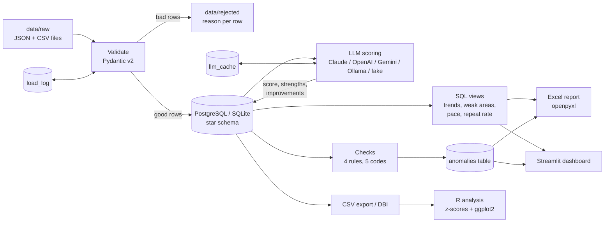

# Architecture

Interview Prep Analytics is a small batch pipeline. Raw practice files go in, validated rows are
stored in a star schema, an LLM scores each answer, checks look for problems, and the results
come out as an Excel report and a Streamlit dashboard.

## Stages

| Stage | Module | What it does |
|---|---|---|
| Ingest | `ipa.ingest` | Reads `.json` and `.csv`, validates each row with Pydantic, writes bad rows to `data/rejected/<file>.rejected.jsonl` with the reason, loads good rows into the star schema. **Incremental:** a file already in `load_log` (same name and content hash) is skipped. **Idempotent:** every answer has a content hash (`answer_key`); existing keys are never inserted twice. |
| Speech metrics | `ipa.speech` | Words per minute and filler-word counts, ported from the earlier TypeScript prototype (same "so" and "like" rules). Stored per answer. |
| LLM workflow | `ipa.llm`, `ipa.workflow` | One client for Anthropic Claude (default), OpenAI, Gemini and any OpenAI-compatible server such as Ollama. Timeouts, retries with exponential backoff, one fallback model, a response cache in the database and strict JSON validation with a repair retry. A clear error is raised when the JSON is still invalid. |
| SQL views | `ipa/sql/views.sql` | Score trend per category per week, weakest categories, weekly pace and filler rate, question repeat rate. The same SQL runs on PostgreSQL and SQLite. |
| Checks | `ipa.checks` | `score_drop`, `llm_validation_failed` / `llm_retry`, `pace_outlier`, `duplicate_answer`. Results are written to the `anomalies` table. |
| Report | `ipa.report` | Excel workbook with sheets Summary, Trends, Weak Areas and Anomalies, with conditional formatting. |
| Dashboard | `ipa.dashboard` | Streamlit app with filters for category, date range and anomaly rule. |
| R analysis | `r/anomaly_stats.R` | Re-computes the score-drop rule in R (rolling mean and standard deviation per category, z < -2) and draws ggplot2 charts. A test proves that R and Python flag the same sessions. |

## The score-drop rule

For every category, answers are ordered by session date. For each answer the previous 10 scores
(at least 5 are needed) give a mean and a sample standard deviation. The answer is flagged when
`z = (score - mean) / sd` is below -2. A zero standard deviation gives no z-score. A session is
flagged when any of its answers is flagged. The Python version is `score_drop_flags()` in
`src/ipa/checks.py`, the R version is `rolling_zscores()` in `r/anomaly_lib.R`.

## Safety and scope

This is a practice and analytics tool. It does not listen to interviews, answer questions in real
time, hide windows or use overlays. API keys are read from `.env` and never stored in code. Tests
and `ipa demo` use a deterministic fake LLM and never call a real API.
